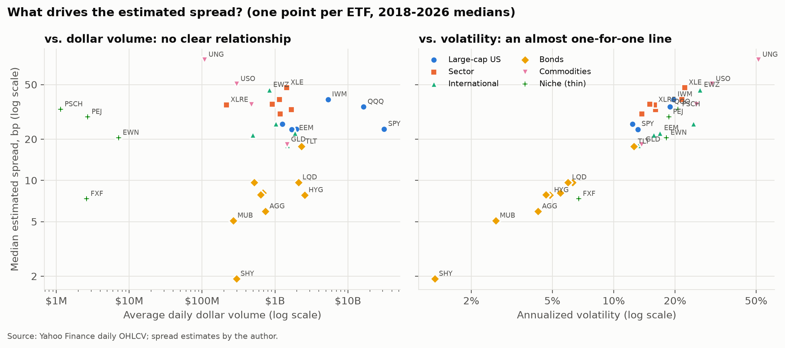
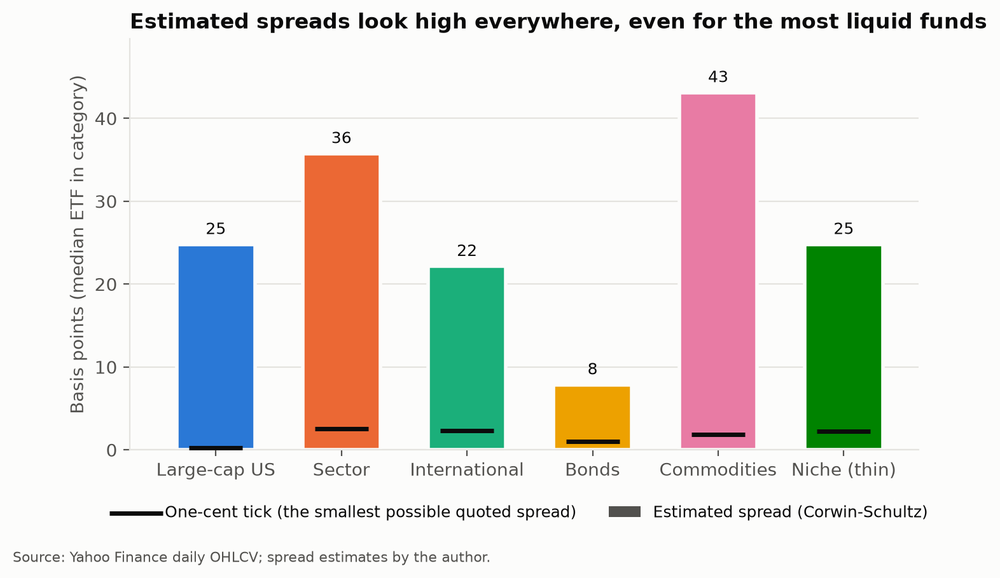
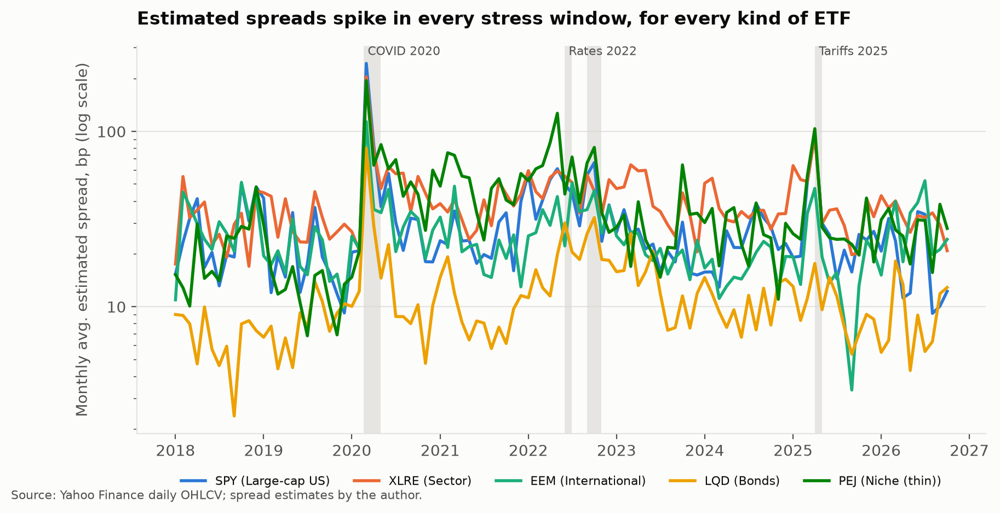
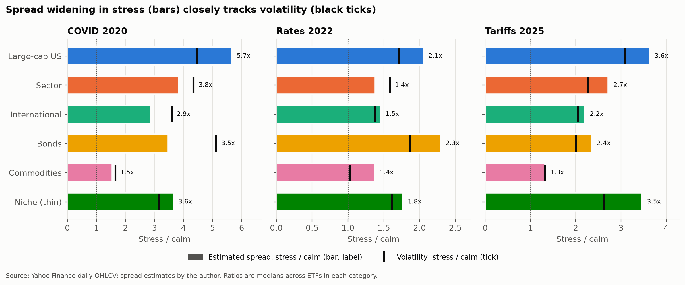
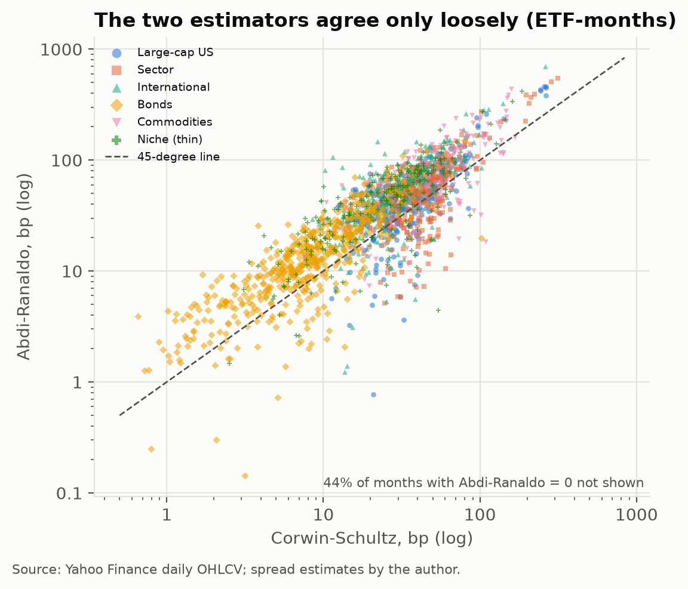

# What Drives ETF Trading Costs?

*Which ETFs are expensive to trade, why, and what happens to their trading costs in market stress? And how much of that can you actually see with free daily data?*

> This README is generated by `python analysis.py` from `readme_template.md`. Every number below comes straight from that run, not typed in by hand.

## Why it matters

For an ETF investor, the bid-ask spread is the round-trip price of getting in and out. For a market maker, it is the price charged for providing liquidity and taking on inventory risk. Knowing which ETFs carry wide spreads, and how spreads behave in a selloff, is the starting point for deciding where to quote, how much to charge, and when investors should hold off on trading.

## Method (plain English)

- **Data:** daily open/high/low/close/volume from Yahoo Finance for **34 ETFs**, Jan 2018 to Nov 17, 2026 (2232 trading days each). The universe covers large-cap US equity, sectors, international equity, bonds, commodities, and four deliberately thin "niche" funds (see below).
- **Spread estimates.** Free quote data doesn't exist, so spreads are inferred from prices with two published estimators:
  - **[Corwin-Schultz (2012)](https://doi.org/10.1111/j.1540-6261.2012.01729.x)** (primary). A day's high is usually a buy at the ask and its low a sell at the bid, so the high-low range contains *volatility + spread*. Volatility grows with the time horizon but the spread doesn't, so comparing one-day ranges with the two-day range separates the two. Includes the paper's overnight-gap adjustment, with negative estimates set to 0.
  - **[Abdi-Ranaldo (2017)](https://doi.org/10.1093/rfs/hhx084)** (cross-check). It measures how far each close sits from the mid-range, net of how the mid-range moves the next day. It is computed per month.
  - Both are unit-tested on hand-worked examples (`python spreads.py`). Daily estimates are averaged into **3604 ETF-months**.
- **Drivers:** for each ETF-month, log average daily dollar volume, annualized realized volatility (std of daily log returns × √252), and asset class.
- **Regression:** pooled OLS of log(spread) on those drivers. Standard errors are clustered by ETF, because months of the same fund aren't independent.
- **Stress:** average spread inside each stress window divided by the average over all non-stress days, for each ETF, compared with the same ratio for volatility.

## Sanity check: failed, and that's the first finding

The spec said SPY's estimated spread should be tiny, in the low single digits of basis points. **It isn't.** Corwin-Schultz puts SPY at **23.7 bp** (Abdi-Ranaldo: 24.5 bp). SPY's real quoted spread is almost always one cent, which at SPY's price is **0.24 bp**. The estimate is roughly **99x** too high.

This is a known weakness of these estimators, not a code bug (the unit tests pass). When the true spread is tiny relative to daily volatility, the high-low range is almost entirely volatility, and any small deviation from the model's assumptions shows up as "spread." The bias is smallest where volatility is low relative to the tick: for SHY (a short-term Treasury fund), the estimate of 1.9 bp is only 1.6x its 1.2 bp one-cent floor. Abdi-Ranaldo struggles in the opposite direction: its monthly estimate is exactly zero in **44%** of ETF-months, and the two estimators' rank correlation is only 0.41.

**So read every "spread" below as "estimated spread," an upper-bound-ish proxy, not a quote.** The findings are about what that proxy picks up.

## Key findings

**1. Estimated trading costs are almost entirely a volatility measure; volume adds nothing.**
Volatility alone explains **0.81** of the variation in log estimated spread, with an elasticity of **0.95** (SE 0.02): 10% more volatility means about 10% more "spread." In the main regression (R² 0.72), +10 points of annualized volatility goes with a **+41%** higher estimate. Holding volatility and asset class fixed, dollar volume has the *wrong sign*: 10x more volume goes with a +11% *higher* estimate (coef +0.047, SE 0.019). The same holds in a pure one-row-per-ETF cross-section (coef +0.043, SE 0.013, R² 0.89). The thinnest funds come out only modestly above SPY (PSCH 33 bp, PEJ 29 bp, SPY 23.7 bp), even though SPY trades about 27,000x more dollar volume than PSCH. Real spreads differ far more than that, so the estimator mostly can't see liquidity differences at this level.



| Main regression: log(spread) on ... | Coefficient | SE (clustered by ETF) |
|---|---|---|
| log(dollar volume) | +0.047 | 0.019 |
| volatility (annualized, decimal) | 3.45 | 0.32 |
| US-equity dummy (vs. bonds) | 1.02 | |
| R², N | 0.72, 3604 ETF-months | |

Dropping volatility and keeping only volume and asset class, R² falls to 0.48. Full output, including log-log and cross-section variants: [`results/regression.txt`](results/regression.txt).



By category, bonds have the lowest estimates (median 7.9 bp) and commodities the highest (43.1 bp), which matches their volatility ranking, not their liquidity ranking.

**2. Spreads blow out in stress, but by about as much as volatility does, including for bonds in March 2020.**
The categories that widened most were Large-cap US (5.7x) in COVID, Bonds (2.3x) in the 2022 rate shock, and Large-cap US (3.6x) in the April 2025 tariff selloff. Across all ETF-windows, the log spread ratio and the log volatility ratio are correlated at **0.86**. For bonds in COVID, estimated spreads rose **3.5x** while volatility rose **5.1x**: LQD 4.8x vs. 5.1x, HYG 4.1x vs. 5.9x, MUB 3.9x vs. 7.8x. In 6 of 9 bond ETFs, the spread rose *less* than volatility.
That doesn't mean bond ETFs were fine. Quote- and NAV-based studies document severe bond-market dysfunction in March 2020, with bond ETFs trading at deep discounts to NAV ([Haddad, Moreira & Muir 2021](https://doi.org/10.1093/rfs/hhab045); [Falato, Goldstein & Hortaçsu 2021](https://doi.org/10.1016/j.jmoneco.2021.05.005)). **This data does not show it.** A range-based estimator can't tell a liquidity shock apart from a volatility shock, and that is the honest answer to the spec's question.




**3. After controlling for volatility, volume and asset class, a residual ranking remains.**
Volatility explains most of the estimate, but the residual (each ETF's average log gap from the log-log model, R² 0.85) ranks funds by "cost relative to risk and volume":
- **Higher than predicted:** EWZ (+29%), USO (+25%), XLRE (+21%), UNG (+21%), XLU (+18%), XLV (+13%)
- **Lower than predicted:** FXF (-24%), FXI (-17%), SPY (-14%), QQQ (-11%), GLD (-11%), IEF (-11%)

The low end includes SPY, QQQ and the big Treasury/gold funds, which are known to be among the cheapest instruments to trade. That gives some face validity. The high end mixes funds with less liquid underlying holdings or harder-to-hedge exposure (Brazil equities, oil and gas futures, REITs) with plain sector funds, so treat it as a list of hypotheses, not a result.



## So what

- **For a market maker:** don't price ETF liquidity off daily high-low data. Here it mostly measures volatility, with a 99x error on SPY. The residual list above is a reasonable *screening* step: funds whose range-implied cost is high for their volatility and volume (EWZ (+29%), USO (+25%), XLRE (+21%), UNG (+21%), XLU (+18%), XLV (+13%)) are where to pull real quote data first and check whether quoted spreads leave room after hedging costs.
- **For an investor:** the one robust pattern is that measured trading costs scale with volatility. In each stress window, estimated costs rose about as much as volatility, a median of 5.7x for large-cap US funds in COVID. The practical rule: avoid market orders in any ETF during volatility spikes, and expect the worst for funds whose underlying holdings trade less often than the ETF itself (bonds, international equity). The literature shows this, but this dataset can't confirm it.
- **For research:** the real deliverable is knowing when the tool fails. For liquid ETFs, a free daily-data spread estimate is a volatility estimate in disguise.

## Limitations

- **Estimators:** upward-biased for very liquid funds (see the sanity check) and noisy day to day. Abdi-Ranaldo is zero in 44% of months. Both assume prices follow a random walk between trades, which fails around news and closing auctions.
- **Daily data:** no quotes, depth or NAV, so no premium/discount, no intraday timing, and no way to tell a widening of the quoted spread apart from wider ranges.
- **Survivorship:** all 34 funds still trade today and were hand-picked. Funds that closed or were too thin to have clean data are excluded, which flatters the "niche" group.
- **Ex-dividend gaps** are handled by the overnight adjustment. Volume and dollar volume use the traded (split-adjusted) close.

**The niche funds** (median daily dollar volume roughly $1-5M, vs. about $30B for SPY) are PSCH (small-cap health care), PEJ (leisure and entertainment), EWN (Netherlands) and FXF (Swiss franc). They cover four different corners of the market, and all have traded continuously since before 2018.

**Next step with real quote (TAQ) data:** compute effective and quoted spreads directly, calibrate the estimators against them, add NAV to measure premium and discount in stress, and test whether the residual screen predicts real spreads.

## Reproduce

```bash
pip install -r requirements.txt
python analysis.py        # downloads data on first run, then writes charts/, results/, README.md
python spreads.py         # estimator unit tests
```

`config.py` holds the ticker universe, date range (end pinned for reproducibility) and stress windows.
